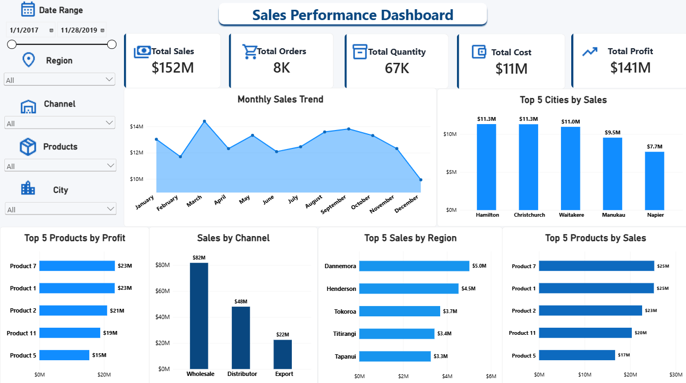

# 📊 Sales Performance Dashboard

An interactive Power BI dashboard designed to analyze sales performance, profitability, regional trends, and product insights.

## 🖥️ Dashboard Preview

## 🎯 Project Overview

This project analyzes sales data to identify key business trends and support data-driven decision-making.

## 📌 Key Performance Indicators (KPIs)

- **Total Sales:** $152M
- **Total Orders:** 8K
- **Total Quantity:** 67K
- **Total Cost:** $11M
- **Total Profit:** $141M

## 📈 Dashboard Insights

- Monthly sales trends over time
- Top 5 cities by sales
- Top 5 products by profit
- Sales distribution by channel
- Top 5 sales-performing regions
- Top 5 products by sales

## 🛠️ Tools & Technologies

- Microsoft Power BI
- DAX (Data Analysis Expressions)
- Data Visualization
- Interactive Filters and Slicers

## ⚙️ Interactive Features

- Date range filtering
- Region, channel, product, and city filters
- Interactive charts and cross-filtering
- KPI cards for quick performance monitoring

## 📂 Project Files

- Sales_Performance_Dashboard.pbix — Power BI dashboard file
- Dashboard_Screenshot.png — Dashboard preview image

## 👨‍💻 Author

**Mohammad Shahid**

Aspiring Data Analyst |Excel | SQL | Python | Power BI

---

*This project was created for data analytics practice and portfolio development.*
